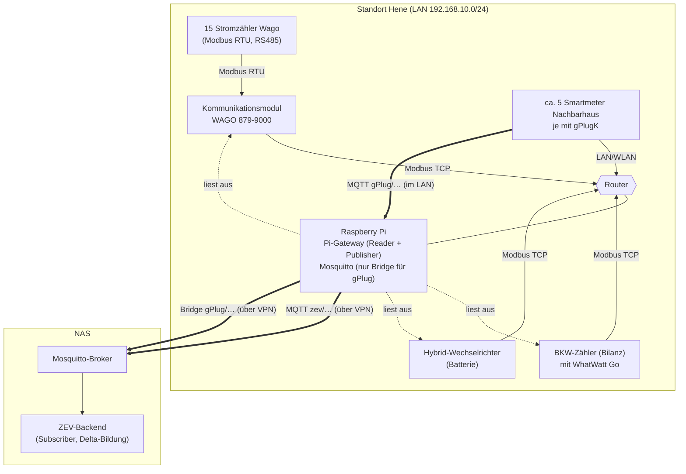

# Netzwerk-Topologie ZEV (Hene)



## Messquellen

| Quelle | Anzahl | Anbindung | Ausgelesen von | MQTT-Topic | Spec |
|--------|--------|-----------|----------------|------------|------|
| Wago-Zähler (Wohnungen, Allgemein, Produktion) | 15 | Modbus RTU → Kommunikationsmodul WAGO 879-9000 → Modbus TCP | Pi-Gateway | `zev/{orgId}/{messpunkt}/messwert` | `Specs/Pi-Gateway-Software.md` |
| BKW-Zähler (Bilanz: Bezug und Rücklieferung) | 1 | WhatWatt Go, Modbus TCP | Pi-Gateway | `zev/{orgId}/{messpunkt}/messwert` | `Specs/Bilanzmesspunkt.md` |
| Batterie (Hybrid-Wechselrichter) | 1 | Modbus TCP am Wechselrichter | Pi-Gateway | `zev/{orgId}/{messpunkt}/messwert` | `Specs/Batteriespeicher.md` |
| Smartmeter Nachbarhaus | ca. 5 | gPlugK, publiziert selbst per MQTT | – (kein Reader) | `gPlug/{orgId}/{messpunkt}/tele/SENSOR` | `Specs/MQTT-Integration.md`, FR-10 |

## Datenfluss

* **Pi-Gateway:** Der Pi liest die 17 Zähler per Modbus TCP und **publiziert die absoluten
  Zählerstände** über den VPN-Tunnel direkt an den Mosquitto-**Broker auf dem NAS**
  (Variante B, unten).
* **gPlugs:** Sie publizieren ihre Meldungen selbst – ohne Pi-Gateway-Software. Weil sie weder
  VPN noch TLS beherrschen, erreichen sie den NAS nicht direkt: Sie publizieren an einen
  **Mosquitto auf dem Pi** im LAN, der **nur** `gPlug/#` per **Bridge** über das VPN an den
  NAS-Broker weiterleitet. Der Pi-Broker ist reiner Vermittler; er liest nichts aus und
  verändert keine Meldung.
* **ZEV-Backend:** abonniert beide Topics auf dem NAS-Broker und **bildet die
  Deltas/15-Minuten-Werte** selbst — verlusttolerant (siehe `Specs/MQTT-Integration.md`).

> **Rollentrennung – ein Broker liest keine Zähler:** Mosquitto **verteilt nur Nachrichten** und
> spricht kein Modbus. Das Auslesen der Wago-, BKW- und Batteriezähler übernimmt der
> **Reader/Publisher-Prozess** auf dem Pi (`pi-gateway`). Die gPlugs sind Reader und Publisher
> in einem.

Der frühere SFTP-Weg ist abgelöst (Anhang).

## Verbesserungspotenzial der Architektur

Folgende Punkte erhöhen Sicherheit, Erreichbarkeit und Datenqualität — geordnet nach Wirkung.

### 1. VPN-Richtung umdrehen: Pi als Client statt Server

> **Offen – Stand klären:** Das frühere Diagramm dieser Doku zeigte den Pi bereits als
> VPN-**Client** und den NAS als VPN-**Server**; dieser Abschnitt geht vom Gegenteil aus.
> Ist der Pi schon Client, ist der Punkt erledigt und gehört in den Anhang.

Ist der Pi der VPN-Server, muss der Router am Zählerstandort aus dem
Internet erreichbar sein (Port-Forwarding + DynDNS). Das ist das größte Risiko:

- **CGNAT-Problem**: Viele ISPs vergeben kein öffentlich erreichbares IPv4 mehr
  → eingehendes VPN funktioniert dann gar nicht.
- **Angriffsfläche**: Ein aus dem Internet erreichbarer offener Port am
  Wohnstandort.

**Besser**: Der Pi wählt sich *ausgehend* beim NAS (oder einem kleinen
Cloud-Endpoint) als VPN-**Client** ein. Der Tunnel ist danach bidirektional —
der Pi erreicht den NAS-Broker, und für die Wartung bleibt der Pi per SSH erreichbar. Vorteile: kein Port-Forwarding,
CGNAT-tauglich, keine Inbound-Exposition am Zählerstandort. WireGuard eignet
sich dafür ideal (schlank, läuft gut auf dem Pi).

### 2. Netzwerk-Segmentierung für die Zähler

Modbus TCP ist **unverschlüsselt und ohne Authentisierung**, und die gPlugs sprechen MQTT ohne
TLS. Aktuell hängen Zähler, gPlugs, Pi und der VPN-Pfad im selben flachen LAN; ein
kompromittiertes Gerät erreicht alles.

→ Zähler und gPlugs in ein eigenes VLAN / separates Netzsegment legen; nur der Pi darf per
Modbus dorthin, und nur die gPlugs dürfen den Broker auf dem Pi erreichen. Trennt OT (Zähler)
von IT (Pi/NAS-Pfad).

### 3. Datenpipeline härten (Korrektheit)

- **Pi-Speicher**: Nicht auf die SD-Karte schreiben (Wear-out → Datenverlust). Das gilt auch für
  die `persistence` des Mosquitto auf dem Pi: USB-SSD oder zumindest Log-Rotation.
- **NTP auf dem Pi und auf den gPlugs**: Zählerwerte brauchen korrekte Zeitstempel — eine
  driftende Uhr verfälscht die ganze ZEV-Abrechnung. Die gPlugs stempeln ihre Meldungen selbst
  (Zeitzone und Sommerzeit im Abschnitt „gPlugK“ unten).

### 4. Monitoring gegen stillen Ausfall

Das Backend meldet Datenlücken eines Zählers als Systemmeldung (`MQTT_ZAEHLER_LUECKE` /
`MQTT_ZAEHLER_AUSFALL`, `Specs/MQTT-Integration.md`, FR-8.3) – allerdings erst, **wenn wieder
Daten eintreffen**. Ein laufender Totalausfall (Pi, VPN, Bridge oder Broker) bleibt bis dahin
still. Abhilfe: in Grafana einen Alert auf `zev_mqtt_last_message_timestamp` (FR-8.1).

## Setup-Notiz: MQTT-Broker auf dem NAS betreiben

Der Broker auf dem NAS nimmt die Meldungen des Pi-Gateways und – über die Bridge des Pi – die
der gPlugs entgegen. Er läuft als Service `mosquitto` im ZEV-Stack
(`docker-compose-mqtt-hene.yml`, lokal `docker-compose-mqtt.yml`) und wird aus
`pi-gateway/deploy/mosquitto/` gebaut:

| Datei | Inhalt |
|-------|--------|
| `Dockerfile` | `eclipse-mosquitto:2` mit eingebackener `mosquitto.conf` und eigenem Entrypoint |
| `mosquitto.conf` | Listener, Persistenz, Puffer der dauerhaften Backend-Sitzung, `queue_qos0_messages` |
| `docker-entrypoint.sh` | erzeugt beim Start die `passwd` aus `MOSQUITTO_USERS` – keine Passwörter im Image oder im Repo |

> **Wozu `persistence`:** Die dauerhafte Sitzung des Backends hält der Broker im
> Speicher. Für einen **Neustart des Backends** (Update) genügt das. Damit die
> gepufferten Nachrichten auch einen **Neustart des Brokers** überstehen, braucht es
> `persistence true` mit einem Volume für `/mosquitto/data/`.

### 1. Benutzer (`MOSQUITTO_USERS`)

In der `.env` des Stacks, Paare `user:passwort` durch Leerzeichen getrennt. Passwörter dürfen
kein Leerzeichen enthalten; ein Doppelpunkt im Passwort ist erlaubt (nur der erste trennt).

```
MOSQUITTO_USERS=zev-backend:<passwort> pi-org42:<passwort> zevbridge:<passwort>
```

| User (Beispiel) | Wer | Gegenstück |
|-----------------|-----|------------|
| `zev-backend` | ZEV-Backend (Subscriber) | `MQTT_BROKER_USERNAME` / `MQTT_BROKER_PASSWORD` in derselben `.env` |
| `pi-org42` | Pi-Gateway (Publisher) | `MQTT_USERNAME` / `MQTT_PASSWORD` in `/etc/pi-gateway.env` auf dem Pi |
| `zevbridge` | Bridge des Pi für die gPlugs | `remote_username` / `remote_password` in `/etc/mosquitto/conf.d/bridge.conf` auf dem Pi |

Die `passwd` entsteht beim Start des Containers. Ein neuer oder geänderter User wirkt deshalb
erst nach dem Neuerzeugen des Containers:

```bash
docker compose -f docker-compose-mqtt-hene.yml up -d mosquitto
```

Backend und Pi-Gateway verbinden sich danach selbst neu.

### 2. Konfiguration ändern

Die `mosquitto.conf` ist ins Image gebacken. Nach einer Änderung im Repo die Dateien aus
`pi-gateway/deploy/mosquitto/` in das Build-Verzeichnis des Stacks auf dem NAS bringen (die
Hene-Compose baut aus `./mosquitto` neben der Compose-Datei) und neu bauen:

```bash
docker compose -f docker-compose-mqtt-hene.yml up -d --build mosquitto
```

Dass die neue Konfiguration greift, zeigt der Container selbst:

```bash
docker exec mosquitto grep queue_qos0 /mosquitto/config/mosquitto.conf
```

### 3. Zugriffsregeln (ACL) – noch nicht aktiv

Der NAS-Broker hat heute **keine** `acl_file`: Jeder angemeldete User darf jedes Topic lesen und
schreiben. Sobald eine `acl_file` aktiv ist, verliert **jeder User den Zugriff, der nicht darin
steht** – also zuerst die echten Usernamen aus `MOSQUITTO_USERS` zusammentragen. Vorschlag
(`42` = org_id des Mandanten):

```conf
user pi-org42
topic write zev/42/+/messwert

user zevbridge
topic write gPlug/42/+/tele/#

user zev-backend
topic read zev/+/+/messwert
topic read gPlug/+/+/tele/SENSOR
# der Healthcheck des Containers publiziert als Backend-User
topic write healthcheck
```

Einbau: Datei als `pi-gateway/deploy/mosquitto/acl` anlegen, im `Dockerfile` nach
`/mosquitto/config/acl` kopieren, in der `mosquitto.conf` `acl_file /mosquitto/config/acl`
ergänzen, neu bauen (Abschnitt 2).

### Sicherheit

- **`allow_anonymous false`** + Passwort ist Pflicht — sonst kann jeder im Netz
  publizieren/mitlesen.
- **TLS (Port 8883)**: Auch über den VPN-Tunnel zusätzlich per TLS absichern
  (Defense-in-Depth). Zertifikate ins `config/`-Verzeichnis und in
  `mosquitto.conf` den `listener 8883` mit `cafile`/`certfile`/`keyfile`
  ergänzen. Pi-Gateway und Bridge können TLS; die gPlugs nicht – deshalb gehen sie über
  die Bridge.
- **ACLs**: siehe Abschnitt 3 (noch nicht aktiv).
- **Firewall**: Port 1883/8883 nur über den VPN-Pfad zugänglich machen, nicht
  im offenen LAN und nicht aus dem Internet erreichbar.

### Einordnung in die ZEV-Architektur

```
Pi-Gateway (Publisher) ───────────VPN──┐
                                       ├──> NAS:1883/8883 (Mosquitto) ──> ZEV-Backend (Subscriber)
gPlugs ──LAN──> Pi (Mosquitto, Bridge) ┘
```

Das ZEV-Backend (Spring Boot) abonniert die Werte per MQTT-Client
(`spring-integration-mqtt` / Eclipse Paho) — das ist der Implementierungsteil aus
der Spec `MQTT-Integration.md`.

**Verfügbarkeit / Verlusttoleranz**: Pi-Gateway und gPlugs übertragen
**absolute Zählerstände** (nicht Deltas), die Delta-Bildung macht das Backend.
Dadurch ist ein Nachrichtenverlust **unkritisch**: Fällt Broker/VPN kurz aus,
schliesst der nächste übertragene Stand die Lücke, die Gesamtsumme bleibt korrekt
(nur die zeitliche Auflösung sinkt kurz). Der frühere MQTT-Nachteil („puffert nur
begrenzt" → QoS 1/2 + `persistence` + `clean_session false` nötig) entfällt damit
weitgehend — **QoS 0/1 genügt**, ein Store-and-Forward-Puffer ist optional.
Damit bei einem Update des Backends auch die 15-Minuten-Auflösung erhalten bleibt,
verbindet es sich mit dauerhafter Sitzung (`mqtt.clean-session=false`, Standard)
und QoS 1; der Broker puffert dann bis `max_queued_messages` (Abschnitt 2), die
QoS-0-Meldungen der gPlugs nur mit `queue_qos0_messages true`.

### Wo läuft der Broker? — Varianten A/B/C

Technisch kann Mosquitto auf dem NAS *oder* dem Raspberry Pi laufen. Die Frage
ist nicht *ob*, sondern auf *welcher* Seite — es gibt drei sinnvolle Varianten.

#### Variante A — Broker auf dem Pi

```
Pi: Zähler-Reader → Broker (localhost)  ──VPN──>  NAS: ZEV-Backend (Subscriber)
```

- **Pro**: Publisher und Broker lokal → Publizieren funktioniert immer, auch bei
  VPN-/NAS-Ausfall. Der Broker puffert (persistence + QoS + retained) direkt an
  der Quelle (spiegelt die Resilienz des SFTP-Pull-Modells).
- **Contra**: Das NAS muss den Pi erreichen, um zu abonnieren → der für ZEV
  wichtige Konsument hängt an Pi + Tunnel. Zudem SD-Karten-Wear und geringere
  Uptime als ein NAS.

#### Variante B — Broker auf dem NAS (Empfehlung)

```
Pi: Zähler-Reader (Publisher)  ──VPN──>  NAS: Broker → ZEV-Backend (localhost)
```

- **Pro**: Der eigentliche Konsument (ZEV) verbindet sich lokal zum Broker →
  stabilste Verbindung dort, wo die Geschäftslogik läuft. NAS ist i. d. R. 24/7
  und robuster als der Pi. Pi bleibt schlank (nur Lesen + Publizieren).
- **Contra**: Fällt NAS oder VPN aus, schlägt das Publizieren fehl → der Pi
  braucht eigene Pufferung (siehe Variante C).

#### Variante C — Broker auf beiden, MQTT-Bridge (maximale Resilienz)

Ein lokaler Broker auf dem Pi nimmt die Messwerte entgegen und leitet sie per
Mosquitto-**Bridge** store-and-forward an den NAS-Broker weiter, sobald der
Tunnel steht.

```
Pi: Reader → lokaler Broker ──(Bridge/VPN)──> NAS-Broker → ZEV
```

- **Pro**: Vereint Pufferung an der Quelle *und* lokalen Konsumenten am NAS →
  kein Datenverlust bei VPN-/NAS-Ausfall.
- **Contra**: Zwei Broker = mehr Konfiguration und Betrieb. Für einen Standort
  mit einem Pi tendenziell Overkill.

#### Umsetzung bei Hene

* **Pi-Gateway: Variante B.** ZEV (Konsument) dockt lokal und stabil an, der NAS hat die
  höhere Uptime, das Pi-Gateway bleibt reiner Publisher. Da absolute Zählerstände
  verlusttolerant sind, genügt Variante B; Variante C wäre nur nötig, wenn auch die
  *zeitliche Auflösung* während Ausfällen lückenlos bleiben soll.
* **gPlugs: schmale Variante C.** Ein Broker auf dem Pi mit Bridge zum NAS, aber **nur für
  `gPlug/#`** – nicht, um Ausfälle zu überbrücken, sondern weil die gPlugs den NAS ohne VPN
  und TLS nicht erreichen. Nebeneffekt: Der Pi-Broker puffert ihre Meldungen auch während
  eines VPN-Ausfalls.

## Setup-Notiz: MQTT-Broker auf dem Raspberry Pi (Bridge für die gPlugs)

Der Mosquitto auf dem Pi nimmt die Meldungen der gPlugs im LAN entgegen und leitet **nur**
`gPlug/#` per Bridge an den NAS-Broker weiter. Das Pi-Gateway publiziert weiterhin **direkt**
an den NAS (Variante B) und benutzt diesen Broker nicht.

Vorlagen liegen in `pi-gateway/deploy/mosquitto-bridge/` und kommen mit dem Pi-Gateway-Paket
nach `/opt/pi-gateway/deploy/mosquitto-bridge/`:

| Vorlage | Ziel auf dem Pi | Anpassen |
|---------|-----------------|----------|
| `zev.conf` | `/etc/mosquitto/conf.d/zev.conf` | nichts |
| `acl.example` | `/etc/mosquitto/acl` | org_id (`42`) |
| `bridge.conf.example` | `/etc/mosquitto/conf.d/bridge.conf` | NAS-Adresse, Passwort des Users `zevbridge` |

> **Zwei Fallen in Mosquitto-Konfigurationen:** `persistence`, `persistence_location` und
> `log_dest` setzt schon die Debian-Datei `/etc/mosquitto/mosquitto.conf` – doppelt eingetragen
> bricht Mosquitto beim Start ab. Und Mosquitto kennt nur ganze Kommentarzeilen: In
> `listener 1883 # …` würde `#` als Bind-Adresse gelesen, in `address … # …` als weitere
> Broker-Adresse.

### 1. Voraussetzung auf dem NAS

User `zevbridge` in `MOSQUITTO_USERS` ergänzen und den Broker-Container neu erzeugen
(NAS-Abschnitt 1). Ohne ihn lehnt der NAS die Bridge ab (`not authorised` im Log des Pi).

### 2. Installation

```bash
sudo apt update && sudo apt install -y mosquitto mosquitto-clients
```

### 3. Konfiguration aus den Vorlagen

```bash
V=/opt/pi-gateway/deploy/mosquitto-bridge
sudo cp $V/zev.conf /etc/mosquitto/conf.d/zev.conf
sudo cp $V/acl.example /etc/mosquitto/acl
sudo cp $V/bridge.conf.example /etc/mosquitto/conf.d/bridge.conf
sudo nano /etc/mosquitto/acl                    # org_id eintragen
sudo nano /etc/mosquitto/conf.d/bridge.conf     # NAS-Adresse und Passwort eintragen
```

Die NAS-Adresse ist dieselbe wie `broker.url` in `/opt/pi-gateway/config.yaml` (ohne `tcp://`).

### 4. User für die gPlugs und Rechte

```bash
sudo mosquitto_passwd -c /etc/mosquitto/passwd gplug   # -c nur beim ersten User
sudo chown mosquitto:mosquitto /etc/mosquitto/passwd /etc/mosquitto/acl /etc/mosquitto/conf.d/bridge.conf
sudo chmod 600 /etc/mosquitto/passwd /etc/mosquitto/conf.d/bridge.conf
```

`bridge.conf` enthält das Passwort des Users `zevbridge` und darf nur für `mosquitto` lesbar sein.

### 5. Starten und prüfen

```bash
sudo systemctl enable --now mosquitto
sudo systemctl restart mosquitto
journalctl -u mosquitto -n 30 --no-pager
```

Im Log steht `Connecting bridge zev-nas-bridge (<nas-adresse>:1883)` und kein `Error`.

### 6. Ende-zu-Ende-Test

Auf dem NAS mitlesen (mit dem Backend-User):

```bash
docker exec -it mosquitto mosquitto_sub -u zev-backend -P '<passwort>' -t 'gPlug/#' -v
```

Auf dem Pi eine Testmeldung senden:

```bash
mosquitto_pub -h localhost -u gplug -P '<passwort>' -t 'gPlug/42/TEST/tele/SENSOR' -m '{"Time":"test"}'
```

Erscheint sie auf dem NAS, steht die Bridge. Solange das Backend `gPlug/…` noch nicht
abonniert (`Specs/MQTT-Integration.md`, FR-10), bleiben solche Meldungen folgenlos. Danach die
gPlugs konfigurieren (Abschnitt „gPlugK“ unten) und mit `mosquitto_sub` auf dem Pi prüfen, ob
ihre Meldungen ankommen.

### Fehlerbilder

| Im Log des Pi (`journalctl -u mosquitto`) | Ursache |
|-------------------------------------------|---------|
| `Duplicate persistence_location value` o. ä. | `persistence…`/`log_dest` doppelt – aus `zev.conf` entfernen |
| `Error: Unable to open pwfile` / `Unable to open acl_file` | Pfad falsch oder Datei nicht für `mosquitto` lesbar (Schritt 4) |
| `Connection Refused: not authorised` bei der Bridge | `zevbridge` fehlt in `MOSQUITTO_USERS` oder Passwort falsch (Schritt 1) |
| Bridge verbindet sich nicht, kein Refused | NAS-Adresse falsch oder VPN weg – `mosquitto_sub -h <nas-adresse> -u zevbridge …` vom Pi aus testen |
| gPlug-Meldung kommt auf dem Pi nicht an | `MqttHost`/`MqttUser` im gPlug falsch, Firewall, oder org_id in `acl` und FullTopic verschieden |

### Sicherheit / Pi-spezifisch

- **`allow_anonymous false`** + Passwort ist Pflicht.
- **Firewall**: Port 1883 auf dem Pi nur aus dem LAN (`192.168.10.0/24`), nicht über das
  VPN-Interface und nicht aus dem Internet. Die gPlugs senden unverschlüsselt – Segmentierung
  siehe „Verbesserungspotenzial“, Punkt 2.
- **Persistence** nicht auf die SD-Karte (USB-SSD), `autosave_interval` erhöhen.
- **Autostart**: `systemctl enable --now mosquitto` bringt den Broker nach einem
  Stromausfall selbstständig hoch.

## Zugriff & Diagnose

Praxis-Notizen für den Zugriff auf die Anlage und die Fehlersuche an den Zählern.
Unabhängig vom Broker-Setup oben.

### Geräte-Inventar (Stand: Oktober 2026)

| Gerät                                 | Adresse                                                            | Bemerkung                                                                                                                                                          |
|---------------------------------------|--------------------------------------------------------------------|--------------------------------------------------------------------------------------------------------------------------------------------------------------------|
| Raspberry Pi `rpi4sa`                 | `192.168.10.189` (eth0), `192.168.10.190` (wlan0), VPN `10.8.0.14` | **DHCP-Reservierung** im Router. **Beide** Interfaces liegen im selben Subnetz – bei Scans/Bindings beachten                                                       |
| Router                                | `192.168.10.1`                                                     | `model=P5`, WebUI auf Port 80; dort die **DHCP-Lease-Liste** (zuverlässigste Geräteliste) und die Reservierungen                                                   |
| Kommunikationsmodul **WAGO 879-9000** | `192.168.10.164:502`                                               | Gemeinsame IP für die 15 Wago, je Zähler eine eigene `unit_id`. Details/Grenzen s. u. **Reservierung prüfen** – die IP steht als `host` in der Pi-`config.yaml` |
| WhatWatt Go (BKW-Zähler)              | `192.168.10.193:502`                                               | **Angeschlossen und auslesbar** (Stand 08/2026), **DHCP-Reservierung** im Router; Registerkarte s. u.                                                              |
| **Wechselrichter** (`espressif.lan`)  | `192.168.10.220`                                                   | **Batterie**, vom Pi-Gateway per Modbus TCP gelesen (`Specs/Batteriespeicher.md`). ESP32-basiert, Modbus TCP auf 502 offen, **kein** Port 80, **kein** mDNS. War zeitweise fälschlich als WhatWatt-Kandidat geführt                                   |
| **gPlugK** (Nachbarhaus, ca. 5)        | DHCP, Adressen nachtragen                                          | Tasmota-Oberfläche auf Port 80. Publizieren an den Broker auf dem Pi (`192.168.10.189:1883`), siehe Abschnitt „gPlugK“ unten |

> **Feste Adressen:** Pi und WhatWatt haben eine **DHCP-Reservierung** im Router (Stand 08/2026).
> Die Pi-Adresse ist zusätzlich als `MqttHost` in allen gPlugs eingetragen.
> Wichtig, weil die IP des WhatWatt (`192.168.10.193`) und die des WAGO-Moduls (`192.168.10.164`)
> als `host` in der Pi-`config.yaml` stehen: ein Lease-Wechsel würde die betroffenen Zähler
> **stillschweigend** ausfallen lassen (Read-Fehler, keine Rohdaten). Für das WAGO-Modul ist
> die Reservierung daher ebenfalls zu setzen, falls noch nicht vorhanden.

### Werkzeuge installieren

```bash
sudo apt update && sudo apt install -y avahi-utils arp-scan nmap
# mbpoll für Modbus (falls nicht vorhanden)
sudo apt install -y mbpoll
```

### Zugriff auf die Anlage

```bash
ssh nafam@10.8.0.14                       # Pi über den VPN-Tunnel
```

**WebUIs im Zählernetz von der Workstation aus erreichen** – per SOCKS-Proxy über den
Pi (dynamische Weiterleitung). Gegenüber `-L`-Portweiterleitung robuster, weil
Router-Oberflächen oft absolute URLs/Redirects auf ihre echte IP verwenden:

```bash
ssh -N -D 1080 nafam@10.8.0.14
```

- **Firefox**: Einstellungen → Netzwerk-Einstellungen → Manuelle Konfiguration →
  SOCKS-Host `localhost`, Port `1080`, **SOCKS v5**, „DNS über SOCKS v5" aktivieren.
- Aufruf dann mit der **echten** Adresse: `http://192.168.10.1/`

Einzelner Port statt Proxy (Alternative):

```bash
ssh -N -L 8080:192.168.10.1:80 nafam@10.8.0.14      # dann http://localhost:8080
```

### DB-Zugriff auf das NAS (SSH-Tunnel für DB-Tools)

Für Schema-Browsing, Joins oder Exporte mit einem DB-Tool (DBeaver/DataGrip). Für reine
Inspektion im Betrieb gibt es alternativ die **Datenbank-Ansicht** unter `/einstellungen`
(read-only, nur `zev_admin`, s. `Specs/Datenbank-Ansicht.md`).

**Der Tunnel muss auf die Container-IP zeigen, nicht auf `localhost`:**

```bash
ssh <user>@nasnafam.synology.me \
  "sudo docker inspect -f '{{range .NetworkSettings.Networks}}{{.IPAddress}} {{end}}' postgres"
```

```bash
ssh -N -o ServerAliveInterval=30 -L 15432:<container-ip>:5432 <user>@nasnafam.synology.me
```

Das Ziel in `-L` wird **vom NAS** aufgelöst; die Container-IP im Docker-Bridge-Netz
(`zev-network`) ist von dort erreichbar. DB-Tool danach auf `localhost:15432`, Datenbank
`zev`, Credentials aus `.env.mqtt` **auf dem NAS**. Schemas: `zev` (Anwendung), `keycloak`
(Identity).

**Fallen, die uns Zeit gekostet haben:**

| Symptom | Ursache / Lösung |
|---------|------------------|
| `administratively prohibited: open failed` | `AllowTcpForwarding no` in `/etc/ssh/sshd_config` des NAS (DSM-Default). Auf `yes` setzen, `sudo sshd -t` prüfen, `sudo synosystemctl restart sshd`. **DSM-Updates setzen das zurück.** |
| `no pg_hba.conf entry for host "127.0.0.1", user postgres, database zev` | Tunnel zeigt auf `localhost:5432` des NAS — das ist **DSM's eigener PostgreSQL**, nicht die ZEV-DB. Erkennungsmerkmal: Der ZEV-Container sieht Clients immer als `172.x.0.1` (Bridge-Gateway), **nie** als `127.0.0.1`. → Auf die Container-IP tunneln (oben). |
| Tunnel ging gestern, heute nicht mehr | Die Container-IP ändert sich beim Neuaufsetzen des Stacks → neu ermitteln. Dauerhaft stabiler: ZEV-Postgres in der NAS-Compose auf einen freien Host-Port legen (`"15432:5432"` statt `"5432:5432"`, da 5432 von DSM belegt ist) und wieder auf `localhost` tunneln. |

Lokal bewusst Port **15432**: Auf `5432` läuft die lokale Dev-Datenbank — sonst verbindet
sich das DB-Tool unbemerkt auf die falsche Instanz.

```bash
# Diagnose auf dem NAS, wenn der Tunnel steht, aber die Verbindung scheitert
sudo ss -tlnp | grep 5432                         # docker-proxy oder DSM-postgres?
sudo docker ps --format '{{.Names}}\t{{.Ports}}'  # veröffentlicht der Container 5432?
sudo docker logs --tail 20 postgres               # taucht der Versuch überhaupt auf?
```

### Netzwerk-Scan

```bash
sudo arp-scan -I eth0  192.168.10.0/24     # beide Interfaces getrennt scannen,
sudo arp-scan -I wlan0 192.168.10.0/24     # da eth0/wlan0 im selben Subnetz liegen
avahi-browse -art                          # mDNS-Dienste (nur .local-Geräte!)
```

> **`.lan` ≠ `.local`:** `avahi-resolve -a 192.168.10.220` liefert `espressif.lan` –
> die Endung `.lan` ist die **DHCP-Domain des Routers**, nicht mDNS. Geräte ohne
> mDNS-Ankündigung erscheinen deshalb **nicht** in `avahi-browse`, sind aber per
> Router-DNS auflösbar. Verlässlichste Geräteliste bleibt die DHCP-Lease-Liste im Router.

> **Vorsicht mit `nmap -p-`:** Geräte mit knappem Socket-Budget (ESP32) können durch
> einen vollen Portscan überlastet werden und melden Ports dann **fälschlich als
> geschlossen**. Bei Verdacht: einige Minuten warten, dann einen einzelnen, gezielten
> Zugriff (`curl`/`mbpoll`) absetzen.

### Modbus-Diagnose mit `mbpoll`

```bash
HUB=192.168.10.164
mbpoll -a 1 -t 4:float -r 0x600C -c 1 -1 $HUB -p 502    # Wago 1, Bezug (OBIS 1.8.0)
mbpoll -a 2 -t 4:float -r 0x600C -c 1 -1 $HUB -p 502    # Wago 2
mbpoll -a 3 -t 4:float -r 0x600C -c 1 -1 $HUB -p 502    # Wago 3 (… bis 15, unit_id gemäss config.yaml)
mbpoll -t 4:hex -r 0x4000 -c 2 -1 $HUB -p 502 -a 1 -0   # Seriennummer auslesen
```

**Fallen, die uns Zeit gekostet haben:**

| Thema | Merksatz |
|-------|----------|
| **Function Code** | In `mbpoll` ist `-t 3` = **FC04 Input Register**, `-t 4` = **FC03 Holding Register** – die Zahlen sind *nicht* der Function Code! |
| **Adress-Offset** | Ohne `-0` zählt `mbpoll` ab 1, mit `-0` ab 0 (PDU). Datenblätter nennen meist die PDU-Adresse → im Zweifel beide probieren. |
| **`Illegal data address`** | Das Gerät **antwortet** – nur die Adresse (oder der Bereich `-c`) ist falsch. Bei `:float` liest `-c 12` bereits **24** Register! |
| **`Connection timed out`** | Meist **kein** Adressproblem: viele embedded Server erlauben nur **eine** TCP-Verbindung und brauchen Pausen. Keine Schleifen, 30–60 s warten, `-o 5` für längeren Timeout, `ss -tn \| grep <ip>` auf hängende Verbindungen prüfen. |
| **`exception_code=11`** | „Gateway target device failed to respond" – kommt vom **Kommunikationsmodul**, nicht vom Zähler: es erreicht den Slave auf der **RTU-Strecke** nicht (Verkabelung, Terminierung, Baudrate/Parität, Adresse, Versorgung). Kein Netzwerkproblem – ein IP-Scan hilft hier nicht. **Auch das Client-Timeout des Pi hilft nicht**: das Modul hat ja geantwortet (mit der Exception). **Und ein RTU-Response-Timeout am Modul ist beim 879-9000 nicht einstellbar** (s. u.) – kompensiert wird client-seitig über `read_attempts` (Retry, Default 2). |

> **Client-Timeout des Pi-Gateways:** konfigurierbar über `read_timeout` (global, Default 5 s)
> bzw. `zaehler[].read_timeout` je Zähler (s. `Specs/Pi-Gateway-Software.md`, FR-1.5). Wirkt nur bei
> **ausbleibender** Antwort – nicht bei Exception-Responses wie `code 11` (s. Tabelle).
>
> **Retry des Pi-Gateways:** `read_attempts` (global, Default **2** = ein Wiederholversuch,
> 0,5 s Pause, Verbindung wird neu aufgebaut). Das ist die Kompensation für sporadische
> `code 11`, weil am Modul kein Response-Timeout einstellbar ist. Unschädlich, da absolute
> Zählerstände publiziert werden (`Specs/Pi-Gateway-Software.md`, FR-1.6).

### Das Kommunikationsmodul: WAGO 879-9000

Der „Hub" auf `192.168.10.164` ist **kein** generisches RTU→TCP-Gateway, sondern das
**Kommunikationsmodul der WAGO-MID-Zähler** ([Produktseite](https://www.wago.com/us/communication-module/p/879-9000),
[Kurzanleitung PDF](https://www.tme.eu/Document/20b55b99db28c68f381d2192681b601b/879-9000-de.pdf)).

- Klippt per **seitlicher UART-Schnittstelle** direkt an einen WAGO-Zähler (4PU/4PS/2PU CT),
  wird von dort versorgt und liest dessen Daten — für **diesen** Zähler ist keine RS485-Verbindung nötig.
- Über die **externe RS485** bis zu **32** Modbus-RTU-Zähler; dafür ist eine **externe
  5-V-DC-Versorgung (500 mA)** erforderlich.
- Konfiguration nur mit dem kostenlosen Windows-Tool **`TCPIPModuleConfig`** (Download auf der
  Produktseite). Es findet Module per **Netzwerk-Broadcast** → über den VPN-Tunnel nicht ohne
  Weiteres nutzbar; für die manuelle Eingabe gibt es „Additional device IP". Am einfachsten vor Ort.

**Einstellbar** („Bereich E" des Tools) sind nur die Modbus-Parameter der Schnittstellen:

| Parameter | UART-Seite | Externe RS485 |
|---|---|---|
| Baudrate | 115.200 bd (**fix**) | **300 … 115.200 bd wählbar** |
| Parität | EVEN (**fix**) | EVEN / NONE / ODD |

**Ein Response-/Antwort-Timeout ist nicht vorhanden.** Bei sporadischen `code 11` bleiben daher
als Hebel: **Versorgung prüfen** (bei RS485-Zählern die externen 5 V/500 mA — fehlende Reserve ist
ein plausibler Grund für Ausfälle über alle Zähler), **Baudrate senken** (am Modul *und* an allen
Zählern gleich), **Terminierung** (120 Ω an beiden Busenden, keine langen Stichleitungen) — plus
der client-seitige Retry (`read_attempts`).

> **Diagnostisch wertvoll:** Hängt einer der Zähler per UART direkt am Modul, fällt *der* nie aus
> (nur die RS485-Zähler), ist die RS485-Strecke eindeutig überführt.

**Offener Punkt:** Es treten wiederkehrend `exception_code=11` auf – **nicht immer beim
gleichen Zähler**, sondern über alle verteilt. Das spricht für eine **gemeinsame Ursache auf
der RTU-Strecke** (Versorgung/Baudrate/Terminierung, s. Abschnitt zum 879-9000) und gegen
Verkabelung oder Adresse eines einzelnen Geräts. Häufigkeit und Verteilung auswerten:

```bash
journalctl -u pi-gateway --since "24 hours ago" | grep -o "dev_id=[0-9]*" | sort | uniq -c
```

Trifft es **immer** denselben `dev_id`, deutet das auf Verkabelung/Adresse dieses Geräts;
trifft es sporadisch alle (aktueller Stand), auf eine gemeinsame Ursache auf dem RS485-Bus.
Zum Vergleich unabhängig von unserer Software gegenprüfen:

```bash
for i in $(seq 1 50); do for a in $(seq 1 15); do   # unit_ids gemäss config.yaml
  mbpoll -a $a -t 4:float -r 0x600C -c 1 -1 -o 2 $HUB -p 502 >/dev/null 2>&1 || echo "fail a=$a lauf=$i"
done; done
```

Dieselbe Fehlerrate wie im Dienst → Ursache liegt sicher am Modul/RS485; sauber → unser
Zugriffsmuster spielt mit hinein.

*Auswirkung auf die Daten:* Einzelne fehlgeschlagene Reads sind **folgenlos** – der Pi
publiziert **absolute** Zählerstände, das Delta über die Intervallgrenze bleibt identisch.
Erst wenn ein **ganzes 15-Min-Intervall** ohne Daten bleibt, geht die zeitliche Auflösung
verloren (Verbrauch fällt gebündelt ins Folgeintervall). Das Backend meldet das als
Systemmeldung: **INFO** bei einem Intervall, **WARN** bei mehreren
(s. `Specs/MQTT-Integration.md`, FR-8.3).

### WhatWatt Go (BKW-Zähler)

Doku: https://documentation.whatwatt.ch/ · Modbus: https://documentation.whatwatt.ch/35-modbus/

**REST-API** (Port 80) – der schnellste Weg zur Diagnose:

```bash
curl -sS -m 10 http://<ip>/api/v1/system    # Firmware-Version + Zähler-Verbindungsstatus
curl -sS -m 10 http://<ip>/api/v1/report    # Live-Messwerte als JSON
```

Modbus-Dienst aktivieren/konfigurieren:

```bash
curl -X PUT -H 'Content-Type: application/json' \
  -d '{"services":{"modbus":{"enable":true}}}' \
  http://<ip>/api/v1/settings
```

**Modbus-Registerkarte** (0-basiert, read-only):

| Größe | OBIS | Register | Typ | Anzahl | Scaler | Einheit |
|-------|------|----------|-----|--------|--------|---------|
| Bezug | 1.8.0 | **549** | float | 2 | 3 | Wh |
| Einspeisung | 2.8.0 | **553** | float | 2 | 3 | Wh |

```bash
WW=192.168.10.193
mbpoll -a 1 -0 -t 3:float -r 1   -c 3 -o 5 -1 $WW -p 502     # Probe: Spannungen L1-L3 (~230 V)
mbpoll -a 1 -0 -t 3:float -r 549 -c 4 -o 5 -1 $WW -p 502     # 1.8.0, 3.8.0, 2.8.0, 4.8.0 (FC04!)
mbpoll -a 1 -0 -t 3:float -r 549 -c 1 -o 5 -1 $WW -p 502     # nur Bezug
mbpoll -a 1 -0 -t 3:float -r 553 -c 1 -o 5 -1 $WW -p 502     # nur Einspeisung
```

Bei `:float` zählt `-c` in **Floats**, nicht in Registern (`-c 4` = 8 Register). Die
Spannungsprobe zuerst: zeigt sie ~230 V, sind Adressierung **und** Wortfolge bestätigt.

- Registerkarte über **FC04 (Input Register, `-t 3`)** ab FW 1.2.20; **FC03 erst ab FW 2.0.2**.
- Die Slave-Adresse ist laut Doku bedeutungslos (Gerät antwortet auf jede).
- Das Layout enthält **Padding-Register, die immer 0 liefern** – Nullwerte können also
  einfach die falsche Adresse bedeuten.
- Liefern die *richtigen* Register 0, liest das Gerät nichts vom Zähler: In der Schweiz ist
  die **Kundenschnittstelle am VNB-Zähler oft gesperrt** und muss beim Netzbetreiber
  freigeschaltet werden (teils mit Schlüssel/PIN, der im Gerät zu hinterlegen ist).
  `/api/v1/system` zeigt den Verbindungsstatus.
- **Stand 08/2026: angeschlossen, Register liefern Werte.** Die Registerkarte oben ist durch die
  Geräte-Konfiguration bestätigt (Block `start_address: 549`, `word_order: msw`, `float` = 2
  Register → `1.8.0` = 549, `3.8.0` = 551, `2.8.0` = 553, `4.8.0` = 555). Einträge **ohne `id`**
  sind Padding und liefern konstant 0 – ein Nullwert heisst also oft nur „falsche Adresse".

> **Integrations-Hinweis:** Unser `pi-gateway/gateway/readers/modbus_reader.py` nutzt
> `read_holding_registers` (**FC03**). Ein reiner Config-Eintrag genügt für das WhatWatt
> also nur ab **FW ≥ 2.0.2**; andernfalls braucht der Reader ein Config-Feld
> (z. B. `funktion: input|holding`), das auf `read_input_registers` umschaltet.

### gPlugK (Nachbarhaus)

Der gPlugK sitzt an der Kundenschnittstelle des Smartmeters und publiziert selbst per MQTT
(Firmware auf Tasmota-Basis). Konfiguriert wird **nur die MQTT-Anbindung** – Meldungsstruktur
und Ausleseskript bleiben unverändert (`Specs/MQTT-Integration.md`, FR-10). Je gPlug in der
Tasmota-Konsole (`Topic` = Messpunkt der Einheit im ZEV, `42` = org_id):

```
Backlog MqttHost 192.168.10.189; MqttPort 1883; MqttUser gplug; MqttPassword <passwort>; Topic ID742-Nachbar-1; FullTopic gPlug/42/%topic%/%prefix%/; TelePeriod 60
Backlog Timezone 99; TimeStd 0,0,10,1,3,60; TimeDst 0,0,3,1,2,120
```

Die zweite Zeile stellt Mitteleuropäische Zeit mit Sommerzeit ein; ohne sie stempelt der gPlug
um eine Stunde verschoben. Die Meldungen erscheinen danach auf
`gPlug/42/ID742-Nachbar-1/tele/SENSOR` (Test: Abschnitt 6 der Pi-Broker-Notiz).

> **Vor der Umsetzung im Backend** eine echte Meldung mitschneiden und die Feldnamen gegen
> `Specs/MQTT-Integration.md`, FR-10.3, prüfen (dort offene Frage).


## Anhang – Verlauf

### SFTP-Pull (abgelöst durch MQTT, Oktober 2026)

Bis zur MQTT-Anbindung holte das NAS die Zählerdaten per SFTP beim Pi ab. Die frühere
Einleitung lautete:

> **Zähler-Anbindung:** Die drei **Wago**-Zähler sind per **seriellem Modbus (RTU)** an einen
> **Modbus-TCP-Hub** (RTU→TCP-Gateway) angeschlossen, der am Router hängt; der Pi liest sie per
> **Modbus TCP** über den Hub (gemeinsame Hub-IP, je Zähler eine Unit-/Slave-ID). Der **BKW**-Zähler
> ist separat über **WhatWatt** am Router und kann ebenfalls per **Modbus TCP** ausgelesen werden.
>
> **Datenfluss (Ziel, MQTT):** Der Pi liest die Zähler (Modbus TCP über den Hub / WhatWatt) und
> **publiziert die absoluten Zählerstände** über den VPN-Tunnel an den
> Mosquitto-**Broker auf dem NAS** (Variante B). Das ZEV-Backend abonniert sie und
> **bildet die Deltas/15-Min-Werte** selbst — verlusttolerant (siehe
> `Specs/MQTT-Integration.md`). Der **SFTP-Pull** (NAS holt Dateien beim Pi) ist
> der heutige Weg bzw. Fallback.
>
> *Hinweis:* Das Diagramm zeigt den **Ziel-Pfad (MQTT)**. Der **SFTP-Pull** ist bewusst
> **nicht eingezeichnet** (der Übersichtlichkeit halber), bleibt aber als heutiger Weg/Fallback
> gültig — Details im Abschnitt „Setup-Notiz: Dateiübertragung via SFTP" unten.

Die damalige Setup-Notiz „Dateiübertragung via SFTP“:

Das NAS holt die Zählerdaten-Dateien aktiv beim Raspberry Pi ab (Pull). Als
Übertragungsweg wird **SFTP** (über SSH) verwendet — die sichere Variante
gegenüber Samba/SMB: Verschlüsselung ist immer aktiv, schlüsselbasierte
Authentisierung, nur ein offener Port (22), kleine Angriffsfläche. Zusätzlich
zum VPN-Tunnel ergibt das Defense-in-Depth.

#### Empfohlene Härtung

1. **SSH-Key-Auth statt Passwort**: Public Key des NAS auf den Pi hinterlegen,
   Passwort-Login deaktivieren.
   ```
   # /etc/ssh/sshd_config auf dem Raspberry Pi
   PasswordAuthentication no
   PubkeyAuthentication yes
   ```
2. **Dedizierter, eingeschränkter User** auf dem Pi nur für den Datenabzug
   (z. B. `zevdata`), nicht der Standard-User.
3. **Auf SFTP einsperren** (Chroot, kein Shell-Zugriff aufs restliche System):
   ```
   # /etc/ssh/sshd_config auf dem Raspberry Pi
   Match User zevdata
       ForceCommand internal-sftp
       ChrootDirectory /srv/zev-export
       AllowTcpForwarding no
       X11Forwarding no
   ```
4. **Read-only**: Das NAS holt nur ab und schreibt nicht zurück; das
   Export-Verzeichnis für `zevdata` entsprechend berechtigen.

#### Abholen vom NAS (Beispiel)

Effizient inkrementell mit `rsync` über SSH (überträgt nur geänderte Dateien) —
selbes Sicherheitsniveau wie SFTP, da derselbe SSH-Transport genutzt wird:

```bash
rsync -avz --remove-source-files \
  -e "ssh -i /volume1/keys/zev_id_ed25519" \
  zevdata@<raspberry-pi-vpn-ip>:/srv/zev-export/ \
  /volume1/zev-import/
```

Alternativ rein mit SFTP:

```bash
sftp -i /volume1/keys/zev_id_ed25519 zevdata@<raspberry-pi-vpn-ip>
```

Der Abruf wird am NAS per Cronjob/geplanter Aufgabe periodisch ausgeführt.

Aus „Datenpipeline härten“ (SFTP-spezifisch):

- **Atomare Dateiübergabe**: Pi schreibt in `*.tmp` und benennt erst nach
  vollständigem Schreiben um (`rename`), sonst liest das NAS evtl. halbe
  Dateien. `rsync --remove-source-files` löscht erst nach erfolgreicher
  Übertragung.

Aus „Monitoring gegen stillen Ausfall“ (vor den Systemmeldungen des Backends):

#### Monitoring gegen stillen Ausfall

Heute merkt niemand, wenn der Pi nicht mehr ausliest oder das NAS nicht mehr
importiert → stiller Datenverlust, der erst bei der Quartalsabrechnung auffällt.
ZEV hat bereits **Prometheus/Grafana** im Stack: Pi einen Heartbeat bzw.
„letzter erfolgreicher Read"-Timestamp exponieren lassen und Alert bei Lücke.

### Frühere Empfehlung: SFTP behalten, MQTT nur bei Bedarf

#### Strategische Alternative: MQTT (Trade-off, kein Muss)

Statt File-Batch + SFTP könnte der **Pi als MQTT-Gateway** die Messwerte an
einen Broker beim NAS publizieren, ZEV abonniert sie (siehe Spec
`MQTT-Integration.md`) → näher an Echtzeit, kein Datei-Handling. Alternativ
direkter Push des Pi an die bestehende `/api/messwerte`-REST-Schnittstelle.

> **Rollentrennung – der Broker liest keine Zähler:** Ein MQTT-Broker (Mosquitto)
> **verteilt nur Nachrichten** und spricht kein Modbus. Das Auslesen der Zähler
> (Modbus TCP / gPlug) übernimmt ein **separater Reader-/Publisher-Prozess** auf
> dem Pi, der die Werte an den Broker *publiziert*. „Pi als MQTT-Gateway" meint
> also zwei Komponenten:
> 1. **Reader/Publisher** – liest die Zähler aus und publiziert (immer nötig, in
>    jeder Variante; **nicht** Teil der Broker-Installation, separat zu
>    implementieren/betreiben).
> 2. **Broker** – nur bei Variante A/C lokal auf dem Pi; bei Variante B nur auf dem NAS.
>
> Der Reader publiziert an den Broker auf `localhost` (diese Verbindung fällt
> praktisch nie aus); das Verlustrisiko bei Ausfällen liegt allein auf der Strecke
> **Broker → NAS** (siehe Pufferung/QoS in den Broker-Setup-Notizen unten).

**Empfehlung**: Das jetzige File/SFTP-Modell vorerst behalten (entkoppelt,
fehlertolerant, einfach zu debuggen) und Punkte 1–4 umsetzen. MQTT erst, wenn
Echtzeit oder deutlich mehr Zähler tatsächlich gefordert sind — sonst
zusätzliche Komplexität (Broker-Betrieb, Verfügbarkeit) ohne klaren Nutzen.

Die frühere Empfehlung zur Broker-Variante:

#### Empfehlung (Broker-Variante)

Für einen Standort mit einem Pi und einem NAS: **Variante B** — ZEV (Konsument)
dockt lokal und stabil an, NAS hat die höhere Uptime, Pi bleibt reiner
Publisher. Da absolute Zählerstände verlusttolerant sind (s. o.), genügt
Variante B; **Variante C** (Bridge auf dem Pi) ist **kein Muss** und nur sinnvoll,
wenn auch die *zeitliche Auflösung* während Ausfällen lückenlos bleiben soll —
nicht zur Vermeidung von Datenverlust. Variante A nur wählen, wenn der
Broker zusätzlich lokale Verbraucher *am Zählerstandort* bedienen soll.

### Frühere Zähler-Topologie

Die Doku zeigte bis Oktober 2026 **drei** Wago-Zähler am „Modbus-TCP-Hub“ und den BKW-Zähler
mit WhatWatt; Batterie und gPlugs fehlten. Die ACL-Empfehlung nannte das Topic
`zev/messwerte/#`, das es nie gab (richtig: `zev/{orgId}/{messpunkt}/messwert`). Die
Beispiele für `mbpoll` verwendeten `HUB=192.168.10.10`, das Geräte-Inventar
`192.168.10.164`. Die Pi-Broker-Notiz beschrieb Variante A/C für die Zählerstände des Pi
(`topic zev/messwerte/# out 1`) statt der Bridge für die gPlugs; ihr früherer Text:

#### Setup-Notiz: MQTT-Broker auf dem Raspberry Pi betreiben (Variante A / C)

Wird nur für **Variante A** (Broker läuft am Zählerstandort) oder als lokale
Hälfte von **Variante C** (Pi-Broker mit Bridge zum NAS) benötigt. Bei der
Standard-Empfehlung (Variante B, Broker nur auf dem NAS) ist dies **nicht** nötig.

Auf dem Pi ist die **native Installation via apt** am schlanksten (systemd,
kein Docker-Overhead). Falls auf dem Pi ohnehin Docker läuft (vgl.
`docs/NAS-Images.md`), geht auch `eclipse-mosquitto:2` analog zur NAS-Anleitung.

##### 1. Installation (nativ, empfohlen)

```bash
sudo apt update
sudo apt install -y mosquitto mosquitto-clients
sudo systemctl enable --now mosquitto     # Autostart nach Reboot/Stromausfall
```

Pfade auf dem Pi (Raspberry Pi OS / Debian):
- Konfig: `/etc/mosquitto/mosquitto.conf` + `/etc/mosquitto/conf.d/*.conf`
- Daten (Persistence): `/var/lib/mosquitto/`
- Logs: `/var/log/mosquitto/`

##### 2. Konfiguration

```conf
# /etc/mosquitto/conf.d/zev.conf
listener 1883
persistence true
persistence_location /var/lib/mosquitto/
autosave_interval 300            # seltener auf Disk schreiben (SD-Karten schonen)
log_dest file /var/log/mosquitto/mosquitto.log

# Keine anonymen Verbindungen!
allow_anonymous false
password_file /etc/mosquitto/passwd
```

> **SD-Karten-Wear:** `persistence` schreibt nach `/var/lib/mosquitto/` — auf der
> SD-Karte führt das zu Verschleiss. `persistence_location` besser auf eine
> USB-SSD legen (vgl. Abschnitt „Datenpipeline härten → Pi-Speicher").

##### 3. Benutzer/Passwort anlegen

```bash
sudo mosquitto_passwd -c /etc/mosquitto/passwd zevpi   # -c nur beim ersten User
sudo systemctl restart mosquitto                       # Passwortdatei laden
```

Getrennte User: einen für den **Zähler-Reader (Publisher, lokal)** und — bei
Variante A — einen für die **NAS/ZEV-Verwaltung (Subscriber über VPN)**.

##### 4. Test (lokal auf dem Pi)

```bash
mosquitto_sub -h localhost -u zevpi -P '***' -t 'zev/messwerte/#' &
mosquitto_pub -h localhost -u zevpi -P '***' -t 'zev/messwerte/test' -m 'hello'
```

##### 5. Variante A — NAS abonniert über VPN

Der Broker muss für das NAS **nur über den VPN-Pfad** erreichbar sein, nicht im
offenen LAN/Internet:

```bash
sudo ufw allow in on wg0 to any port 1883 proto tcp   # nur VPN-Interface (z.B. wg0)
sudo ufw allow in on wg0 to any port 8883 proto tcp   # TLS
sudo ufw deny 1883/tcp                                # sonst dicht
```

Für Pufferung an der Quelle: `persistence true` + QoS 1/2 + ggf. `retained`
(spiegelt die Resilienz des SFTP-Pull-Modells).

##### 6. Variante C — Bridge zum NAS-Broker (store-and-forward)

Der lokale Pi-Broker nimmt die Messwerte entgegen und leitet sie an den
NAS-Broker weiter, sobald der Tunnel steht. Bei Ausfall wird lokal gepuffert und
nachgesendet.

```conf
# /etc/mosquitto/conf.d/bridge.conf
connection zev-nas-bridge
address <nas-vpn-ip>:8883
remote_username zevpi
remote_password ***
# 'out' = vom Pi zum NAS; QoS 1
topic zev/messwerte/# out 1
bridge_protocol_version mqttv311
cleansession false               # + persistence -> puffert bei VPN-/NAS-Ausfall
try_private true
notifications false
restart_timeout 30
# TLS zum NAS-Broker (Defense-in-Depth über den VPN-Tunnel)
bridge_cafile /etc/mosquitto/certs/ca.crt
```

`cleansession false` zusammen mit `persistence true` (Abschnitt 2) sorgt dafür,
dass keine Messwerte verloren gehen, während NAS oder VPN weg sind.

##### Sicherheit / Pi-spezifisch

- **`allow_anonymous false`** + Passwort ist Pflicht.
- **Firewall**: Ports 1883/8883 nur über das VPN-Interface (siehe Schritt 5).
- **TLS (8883)**: Zertifikate nach `/etc/mosquitto/certs/`, im `listener 8883`
  mit `cafile`/`certfile`/`keyfile` bzw. für die Bridge mit `bridge_cafile`.
- **ACLs**: `acl_file` einsetzen, damit der Reader nur in `zev/messwerte/#`
  publizieren darf.
- **Persistence** nicht auf die SD-Karte (USB-SSD), `autosave_interval` erhöhen.
- **Autostart**: `systemctl enable --now mosquitto` bringt den Broker nach einem
  Stromausfall selbstständig hoch.

##### Docker-Alternative (falls Docker auf dem Pi läuft)

Analog zur NAS-Anleitung mit `eclipse-mosquitto:2`; Volumes dann z. B. unter
`/home/pi/mosquitto/{config,data,log}`. Sonst ist die native apt-Installation
für den schlanken Pi vorzuziehen.

### Frühere Broker-Anleitungen (bis 21.10.2026)

Die NAS-Anleitung beschrieb eine manuelle Einrichtung (`/volume1/docker/mosquitto/`, User per
`mosquitto_passwd` im Container), die nicht dem Betrieb entsprach: Der Broker wird aus
`pi-gateway/deploy/mosquitto/` gebaut, die User kommen aus `MOSQUITTO_USERS`. Die
Pi-Anleitung vom 20.10.2026 hätte Mosquitto nicht starten lassen (doppelte
`persistence`-Einträge, Kommentare am Zeilenende). Der frühere Text der NAS-Anleitung:

#### Setup-Notiz: MQTT-Broker auf dem NAS betreiben

Der Broker auf dem NAS nimmt die Meldungen des Pi-Gateways und – über die Bridge des Pi – die
der gPlugs entgegen. Empfohlen: **Eclipse Mosquitto im Docker-Container** (auf Synology:
Container Manager). Mosquitto ist der De-facto-Standard — schlank, stabil, NAS-tauglich. Docker
gibt gegenüber einem NAS-Paket volle Versions- und Konfigurationskontrolle.

https://github.com/sukesh-ak/setup-mosquitto-with-docker

##### 1. Verzeichnisstruktur auf dem NAS

```
/volume1/docker/mosquitto/
├── config/   → mosquitto.conf, passwordfile, acl
├── data/     → persistente Nachrichten (Retained Messages)
└── log/
```

##### 2. mosquitto.conf

```conf
# /volume1/docker/mosquitto/config/mosquitto.conf
listener 1883
persistence true
persistence_location /mosquitto/data/
autosave_interval 300          # alle 5 Min. speichern (Standard 30)
log_dest file /mosquitto/log/mosquitto.log

# Keine anonymen Verbindungen!
allow_anonymous false
password_file /mosquitto/config/passwordfile
acl_file /mosquitto/config/acl

# Puffer fuer die dauerhafte Sitzung des Backends (mqtt.clean-session=false):
# ~1300 Nachrichten pro Stunde (17 Zaehler ueber das Pi-Gateway + ca. 5 gPlugs, etwa
# jede Minute). Der Standard von 1000 je Client reicht nicht einmal fuer eine Stunde
# Unterbruch; 100000 fuer ~3 Tage.
max_queued_messages 100000
# Die gPlugs publizieren mit QoS 0. Ohne diese Zeile verwirft der Broker ihre Meldungen,
# solange das Backend weg ist (Specs/MQTT-Integration.md, NFR-3).
queue_qos0_messages true
# Sitzung einer nicht mehr benutzten Client-ID nach 14 Tagen verwerfen
persistent_client_expiration 14d
```

> **Wozu `persistence`:** Die dauerhafte Sitzung des Backends hält der Broker im
> Speicher. Für einen **Neustart des Backends** (Update) genügt das. Damit die
> gepufferten Nachrichten auch einen **Neustart des Brokers** überstehen, braucht es
> `persistence true` mit einem Volume für `/mosquitto/data/`.

##### 3. docker-compose (Container Manager → Projekt)

```yaml
services:
  mosquitto:
    image: eclipse-mosquitto:2
    container_name: mosquitto
    restart: unless-stopped
    ports:
      - "1883:1883"     # MQTT (intern / über VPN)
      - "8883:8883"     # MQTT über TLS (empfohlen)
    volumes:
      - /volume1/docker/mosquitto/config:/mosquitto/config
      - /volume1/docker/mosquitto/data:/mosquitto/data
      - /volume1/docker/mosquitto/log:/mosquitto/log
```

##### 4. Benutzer/Passwort anlegen

```bash
# im laufenden Container (-c nur beim ersten User, sonst wird die Datei überschrieben)
docker exec -it mosquitto mosquitto_passwd -c /mosquitto/config/passwordfile zevpi
docker exec -it mosquitto mosquitto_passwd /mosquitto/config/passwordfile zevbridge
docker exec -it mosquitto mosquitto_passwd /mosquitto/config/passwordfile zevbackend
# danach Broker neu starten, damit die Datei geladen wird
```

Getrennte User: **`zevpi`** für das Pi-Gateway (Publisher), **`zevbridge`** für die
gPlug-Bridge des Pi und **`zevbackend`** für die ZEV-Verwaltung (Subscriber). Die Namen sind
Beispiele.

##### 5. Zugriffsregeln (ACL)

```conf
# /volume1/docker/mosquitto/config/acl  –  42 = org_id des Mandanten (Beispiel)
user zevpi
topic write zev/42/+/messwert

user zevbridge
topic write gPlug/42/+/tele/#

user zevbackend
topic read zev/+/+/messwert
topic read gPlug/+/+/tele/SENSOR
```

Jeder Publisher schreibt nur in seinen Mandanten; das Backend liest nur und publiziert nie auf
`gPlug/…/cmnd/…` (das wären Befehle an die gPlugs).


